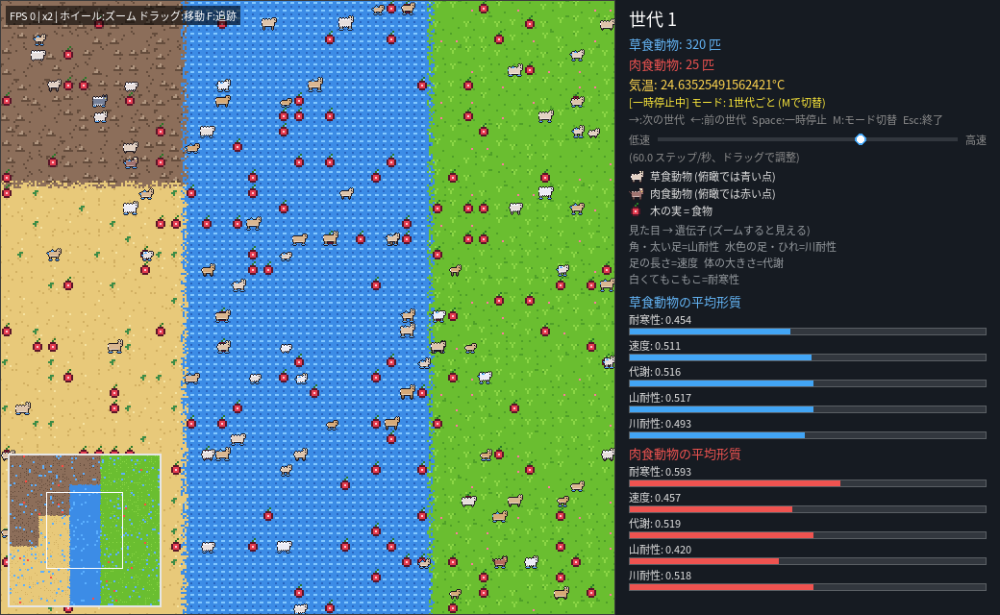

# ゲーム画面のスクリーンショット

Pygameの実際の描画内容を、画面接続のないクラウド環境でSDLの `offscreen` ドライバーを使って保存しました。ゲームのソースコードや計算処理は変更していません。

## 起動直後・操作パネル

現在の実装には独立した設定画面はありません。速度調整スライダー、モード表示、操作説明を含む起動直後の画面です。

[PNGを開く](01_initial.png) — 1000×600、115,816バイト

## シミュレーション進行後

第1世代の200ステップ終了後、第2世代になった画面です。草食77個体、肉食18個体。

[PNGを開く](02_simulation.png) — 1000×600、105,815バイト

## 撮影条件

- Python 3.12 / Pygame 2.6.1
- NumPy乱数シード: 1000
- 初期個体数: 草食320、肉食25
- 気温: 15°C、1世代200ステップ
- 画像サイズ: 両方1000×600ピクセル

GitHubの画像ページで表示できない場合は、Raw表示またはダウンロードを利用してください。

## タイトル画面（新規）

`python main.py` で表示されます（`config.VISUALIZE=True` の場合）。

[タイトル画面PNG](03_title.png)

## ミッションモード仮画面（新規）

[ミッションモードPNG](04_mission.png)

## 神様モードの接続確認

タイトルからミッションへの遷移と復帰、神様モードへの遷移、既存シミュレーションの第1世代200ステップ完了、終了ボタン、ウィンドウの閉じる操作、ホバー、キーボード操作をSDL offscreenで検証しました。実デスクトップ上での手動操作は未検証です。

追加画面は `title_screen.py` に分離されています。日本語フォントはシステムの日本語フォントを優先し、見つからない場合は既存依存の `japanize_matplotlib` 付属フォントを使用します。新しいGUIフレームワークは使用していません。

## main.pyへ統合したドット絵版

`main(pixel).py` の描画・操作を `main.py` へ移行し、タイトルから神様モードへ接続しました。画像は季節変化の確認中、2倍ズーム・1世代ごとモードで撮影した1040×640のPNGです。ズーム、カメラ移動、ミニマップ、世代送り・巻き戻しに伴う気温更新、画面なし実行を確認しています。

## 最新mainの画面（358f801から撮影）

ソース・設定を変更せず `main.py` のタイトルから神様モードへ進み、標準設定（15°C）で撮影しました。乱数シード1000、SDL offscreenを使用しています。

- [タイトル画面](07_current_title.png)
- [起動直後の俯瞰画面](08_current_overview.png)
- [第2世代・2倍ズーム画面](09_current_zoom.png)

## ステータス組み合わせ解説

生物を選択すると右側に数値・3段階評価・総合解説・長所・注意点を表示します。パネル上でホイールスクロール、「閉じる」またはEで従来表示に戻ります。

- [草食動物・現在値と評価](10_status_herbivore.png)
- [組み合わせ総合解説](11_status_summary.png)
- [長所と短所・注意点](12_status_strengths.png)
- [肉食動物・現在値と評価](13_status_carnivore.png)

[設計・閾値・検証手順](../docs/status_explainer.md) / [両方式・全8,748件の解説CSV（ZIP）](../docs/status_combinations.zip)

上記10〜13の画像は、最新の島・海・NN・寿命に対応した解説画面で再撮影しています。行動方式と未使用能力も表示します。

## リーフの観察メモ（短い解説・全体傾向）

- [未選択でも草食・肉食の傾向を表示](14_navigator_overview.png)
- [草食個体を選択した画面](15_navigator_selected.png)
- [肉食個体を選択した画面](16_navigator_carnivore.png)

右側に図形の葉っぱマスコットと3つの吹き出しを表示します。個体の詳しい数値はTabまたは「詳細」で表示でき、以前の10〜13の画像に相当する詳細画面も引き続き利用できます。

[判定ルール・操作説明](../docs/navigator.md)
