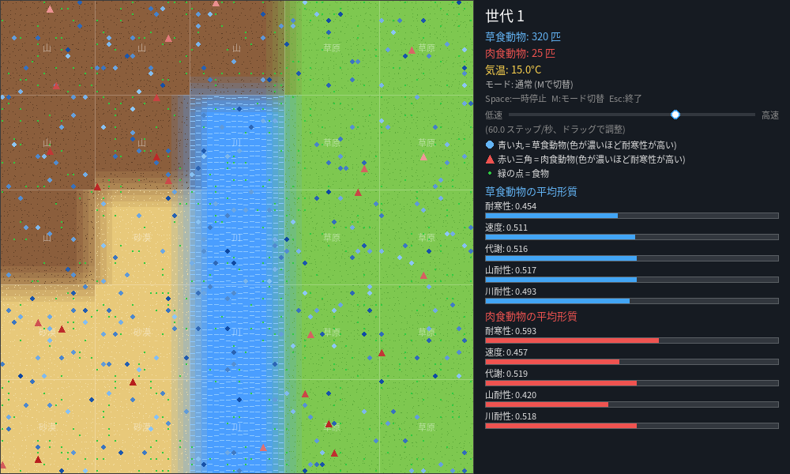
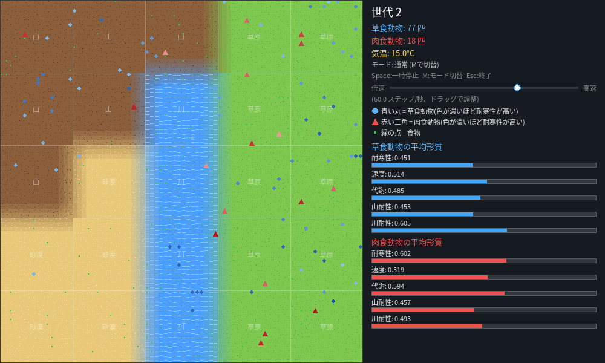
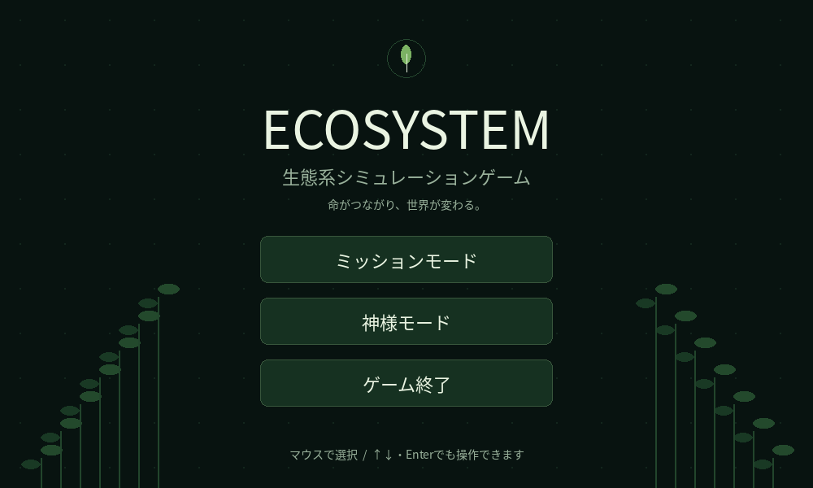
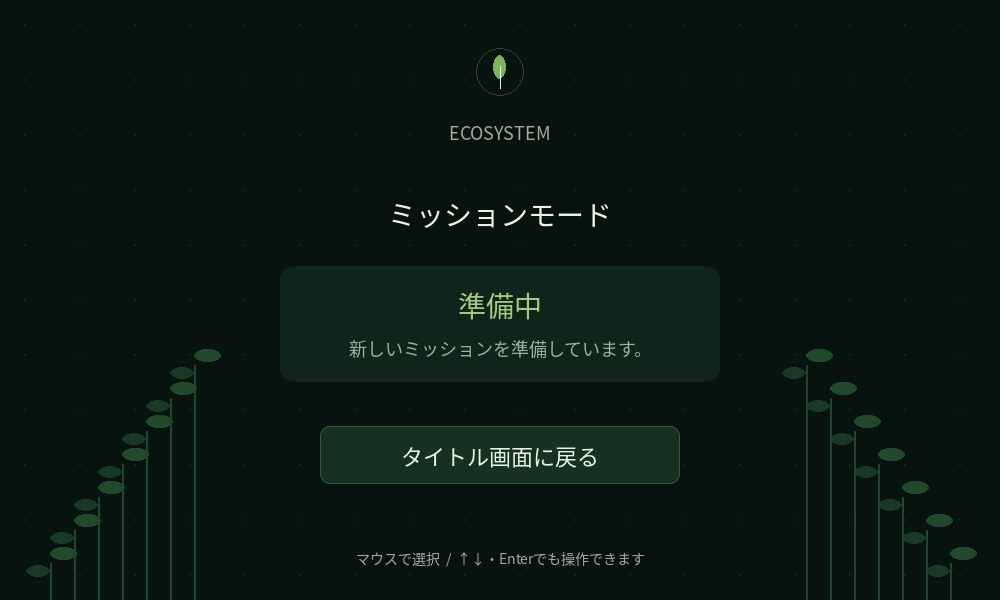

# ゲーム画面のスクリーンショット

Pygameの実際の描画内容を、画面接続のないクラウド環境でSDLの `offscreen` ドライバーを使って保存しました。ゲームのソースコードや計算処理は変更していません。

## 起動直後・操作パネル

現在の実装には独立した設定画面はありません。速度調整スライダー、モード表示、操作説明を含む起動直後の画面です。

[PNGを開く](01_initial.png) — 1000×600、115,816バイト

## シミュレーション進行後

第1世代の200ステップ終了後、第2世代になった画面です。草食77個体、肉食18個体。

[PNGを開く](02_simulation.png) — 1000×600、105,815バイト

## 撮影条件

- Python 3.12 / Pygame 2.6.1
- NumPy乱数シード: 1000
- 初期個体数: 草食320、肉食25
- 気温: 15°C、1世代200ステップ
- 画像サイズ: 両方1000×600ピクセル

GitHubの画像ページで表示できない場合は、Raw表示またはダウンロードを利用してください。

## タイトル画面（新規）

`python main.py` で表示されます（`config.VISUALIZE=True` の場合）。

[タイトル画面PNG](03_title.png)

## ミッションモード仮画面（新規）

[ミッションモードPNG](04_mission.png)

## 神様モードの接続確認

タイトルからミッションへの遷移と復帰、神様モードへの遷移、既存シミュレーションの第1世代200ステップ完了、終了ボタン、ウィンドウの閉じる操作、ホバー、キーボード操作をSDL offscreenで検証しました。実デスクトップ上での手動操作は未検証です。

追加画面は `title_screen.py` に分離されています。日本語フォントはシステムの日本語フォントを優先し、見つからない場合は既存依存の `japanize_matplotlib` 付属フォントを使用します。新しいGUIフレームワークは使用していません。
